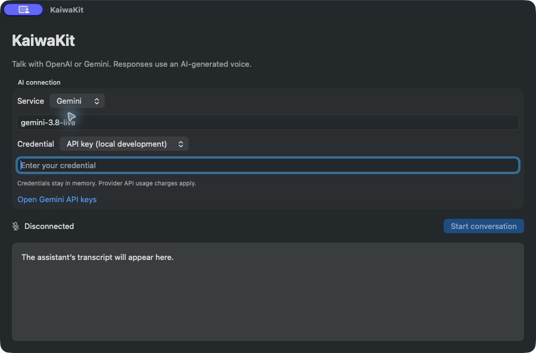

# 🗣️ KaiwaKit

[](https://github.com/shogo4405/KaiwaKit/stargazers)
[](Package.swift)
[](https://jitpack.io/#shogo4405/KaiwaKit)
[](https://github.com/shogo4405/KaiwaKit/actions/workflows/macos.yml)
[](https://github.com/shogo4405/KaiwaKit/actions/workflows/android.yml)
[](https://github.com/shogo4405/KaiwaKit/actions/workflows/documentation.yml)
[](LICENSE)

**Built entirely with AI, for AI voice applications.**

Native Swift and Kotlin libraries for real-time voice conversations with **OpenAI Realtime** and **Gemini Live**, built on HaishinKit.

## ✨ Features

- OpenAI over WebRTC and Gemini over WebSocket.
- A shared conversation API for connection lifecycle, mute, transcripts, and interruptions.
- Full-duplex microphone capture and AI audio playback, with lower-level OpenAI events available when needed.

## 📦 Installation

The examples below track `main`. For releases, select a published version tag in SwiftPM and use the same tag in JitPack.

### 🍎 Swift Package Manager

In Xcode, add `https://github.com/shogo4405/KaiwaKit` as a package dependency, or use:

```swift
.package(url: "https://github.com/shogo4405/KaiwaKit", branch: "main")
```

Add the `KaiwaKit` product to your target. Requires Swift 6 and iOS 15+ or macOS 12+; see [Package.swift](Package.swift) for all supported platforms.

### 🤖 Android · JitPack

Add JitPack to `dependencyResolutionManagement.repositories` in `settings.gradle.kts`:

```kotlin
maven { url = uri("https://jitpack.io") }
```

Then add the library to your app:

```kotlin
implementation("com.github.shogo4405:KaiwaKit:main-SNAPSHOT")
```

Requires Android 10 / API 29+. Android and Apple are separate native SDKs; KMP/CMP is not required.

## 📚 API documentation

- [Swift · DocC](https://shogo4405.github.io/KaiwaKit/swift/documentation/kaiwakit/)
- [Android · Dokka](https://shogo4405.github.io/KaiwaKit/android/)

API references are generated and published when a tag is pushed. The site becomes available after the first successful tag build. See [documentation generation](docs/README.md) for local builds and manual previews.

## 🖼️ Examples

- [Apple](Examples/): SwiftUI voice-chat sample for iOS 16+ and macOS 13.5+. Open `Examples/Examples.xcodeproj` and select **Kaiwa Example**.
- [Android](android/README.md): Jetpack Compose voice-chat sample. Open `android/` in Android Studio.

Download the Apple Silicon app from [GitHub Releases](https://github.com/shogo4405/KaiwaKit/releases). Development snapshots are also available as the **KaiwaKit-macOS-arm64** artifact in [macOS builds](https://github.com/shogo4405/KaiwaKit/actions/workflows/macos.yml).

Both samples let you choose OpenAI or Gemini, enter credentials, mute the microphone, and view transcripts.



*The macOS sample's connection screen, with Gemini selected.*

## 🛠️ Development

Use `Examples/LocalDevelopment.xcworkspace` to work with a neighboring HaishinKit.swift checkout. Android downloads HaishinKit.kt from JitPack. See [build and verification instructions](docs/README.md#-verification).

This is an experimental library. Test audio quality on your target devices and use headphones while evaluating echo behavior.

## 📄 License

BSD-3-Clause
